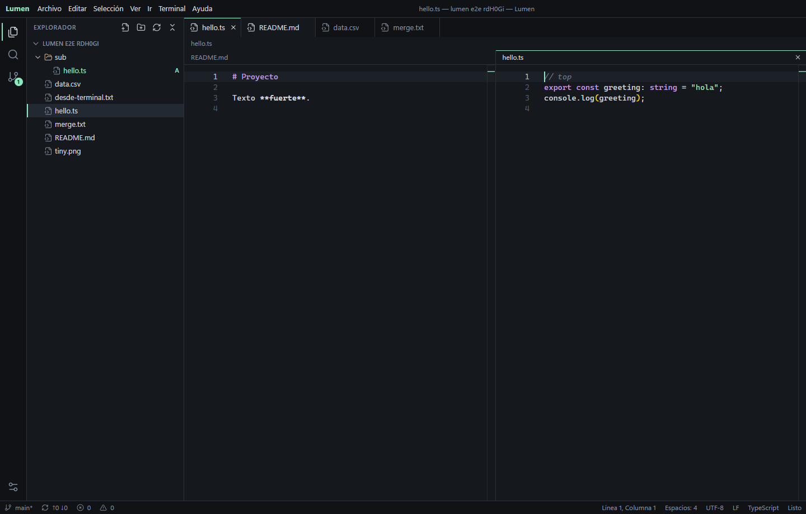

# Lumen

IDE de escritorio ligero hecho con Rust y Tauri. Une el editor Monaco, una terminal real y un flujo de Git completo en un ejecutable de 8 MB.

[Read in English](README.md) · [Descargar para Windows y Ubuntu](https://github.com/u0f/lumen-ide/releases/latest)



## Funciones

**Editor**
- Monaco con pestañas, vista dividida con archivos independientes, vista de diferencias y multicursor
- Resaltado para más de 80 lenguajes; IntelliSense para TS/JS, HTML, CSS y JSON
- Paleta de comandos, apertura rápida de archivos, ir a línea y a símbolo
- Buscar y reemplazar en todos los archivos, con regex, palabra completa y filtros glob
- Vista previa de Markdown, CSV, imágenes, PDF, audio, vídeo y hexadecimal
- Recarga automática si un archivo cambia fuera, con diálogo de conflicto al guardar encima

**Git**
- Stage, unstage, descartar, commit, amend y commit de todo
- Fetch, pull, push, sync y push forzado con lease
- Ramas, merge, rebase, cherry-pick, revert y reset
- Stashes, etiquetas y remotos
- Historial con grafo, diferencias por commit, marcas en el margen y blame en línea
- Resolución de conflictos con Aceptar actual, entrante o ambos

**Terminal**
- Sesiones PTY reales con consola configurable
- Tareas de `package.json`, Cargo, Go, Makefile y `.vscode/tasks.json`

**Carpetas remotas (SSH)**
- Abre una carpeta de otra máquina (`usuario@host:ruta`) y edítala como si fuera local
- Una sola conexión persistente con el `ssh` del sistema: usa tus claves y `~/.ssh/config`, o pide la contraseña una vez; no instala nada en el equipo remoto
- Explorador, búsqueda, Git, terminal y Docker funcionan en la máquina remota
- La barra de estado muestra la conexión; un clic la cierra

**Docker**
- Vista de contenedores debajo de Control de versiones, que solo se actualiza mientras está visible
- Clic derecho para iniciar, detener, pausar, reiniciar, ver o seguir logs, abrir una shell y eliminar

**Agentes de IA**
- Panel de chat con Claude Code y Codex, desde los botones junto a las pestañas
- Chats anteriores, chat nuevo y permisos de solo lectura, edición o acceso total
- Clic derecho en el editor para enviar las líneas seleccionadas al chat
- Usa las CLI oficiales con tu propia cuenta; no queda nada en marcha entre mensajes

**Ajustes**
- 116 opciones en una pestaña propia, con buscador y restablecimiento individual
- Atajos de teclado reasignables
- Interfaz en español, inglés y catalán

## Atajos de teclado

| Acción | Teclas |
| --- | --- |
| Paleta de comandos | `Ctrl+Shift+P` |
| Abrir archivo | `Ctrl+P` |
| Abrir o cerrar consola | `Ctrl+J` |
| Dividir editor | `Ctrl+\` |
| Abrir a un lado | `Ctrl`+clic en el explorador |
| Buscar en archivos | `Ctrl+Shift+F` |
| Control de versiones | `Ctrl+Shift+G` |
| Ajustes | `Ctrl+,` |
| Ejecutar tarea | `Ctrl+Shift+B` |
| Ejecutar archivo activo | `F5` |

## Compilar

Necesitas [Node.js](https://nodejs.org) 20+, [Rust](https://rustup.rs) y [Git](https://git-scm.com).

- **Windows:** Visual Studio Build Tools con la carga de trabajo de C++. WebView2 viene con Windows 11.
- **Linux:** las [dependencias de Tauri](https://tauri.app/start/prerequisites/#linux). En Ubuntu 22.04+:

```bash
sudo apt install build-essential curl file libwebkit2gtk-4.1-dev libssl-dev libxdo-dev libayatana-appindicator3-dev librsvg2-dev
```

Después:

```bash
npm ci
npm run bundle
```

Los instaladores salen en `src-tauri/target/release/bundle/`. Con `npx tauri build --no-bundle` obtienes solo el ejecutable, y con `npm run desktop` desarrollas con recarga en caliente.

Pasa una carpeta para abrirla directamente: `lumen-ide C:\ruta\al\proyecto`.

## Estructura

```
src/                 Frontend en TypeScript
  main.ts            Interfaz principal, comandos, atajos y conexiones
  editor.ts          Monaco, pestañas, paneles, diferencias, blame
  explorer.ts        Árbol de archivos y búsqueda
  git-panel.ts       Control de versiones
  docker-panel.ts    Vista de contenedores
  agent-panel.ts     Chat con Claude y Codex
  terminal.ts        Terminal, salida y problemas
  preview.ts         Vistas previas
  settings.ts        Esquema de ajustes
  settings-page.ts   Pestaña de ajustes
  i18n.ts            Traducciones
src-tauri/           Backend en Rust
  src/workspace.rs   Acceso a archivos limitado al proyecto y búsqueda
  src/git.rs         Operaciones Git
  src/remote.rs      Carpetas remotas por SSH
  src/docker.rs      CLI de Docker
  src/agent.rs       CLI de Claude y Codex e historial de chats
  src/terminal.rs    Sesiones PTY
  src/lib.rs         Comandos de Tauri
e2e/app.mjs          Prueba de extremo a extremo de la app real
public/              Recursos estáticos
```

Para añadir un ajuste, agrega una línea a `CATEGORIES` en `src/settings.ts`. Las opciones con `monaco` llegan al editor sin más código.

## Pruebas

```bash
npm test
npx tsc --noEmit
```

La suite de extremo a extremo solo funciona en Windows. Lanza la app con un puerto local de depuración de WebView2, que las builds release nunca abren, y recorre flujos reales de edición, búsqueda, terminal y Git:

```bash
npm run test:e2e
```

## No incluido

Depurador, extensiones de VS Code, servidores de lenguaje externos, espacios multi-raíz y codificaciones distintas de UTF-8. Los lenguajes que no sean TS/JS, HTML, CSS o JSON tienen resaltado y autocompletado por palabras, y TS/JS señala errores de sintaxis, no de tipos.

La compilación en Linux la comprueba la CI, que también genera el paquete `.deb`; la suite de extremo a extremo no lo cubre. Las carpetas remotas necesitan `find` de GNU, `grep -P` y `base64` en la máquina remota (vienen en Debian, Ubuntu y Raspberry Pi OS). El chat necesita la CLI `claude` o `codex` instalada y con la sesión iniciada.

## Licencia

[MIT](LICENSE)
