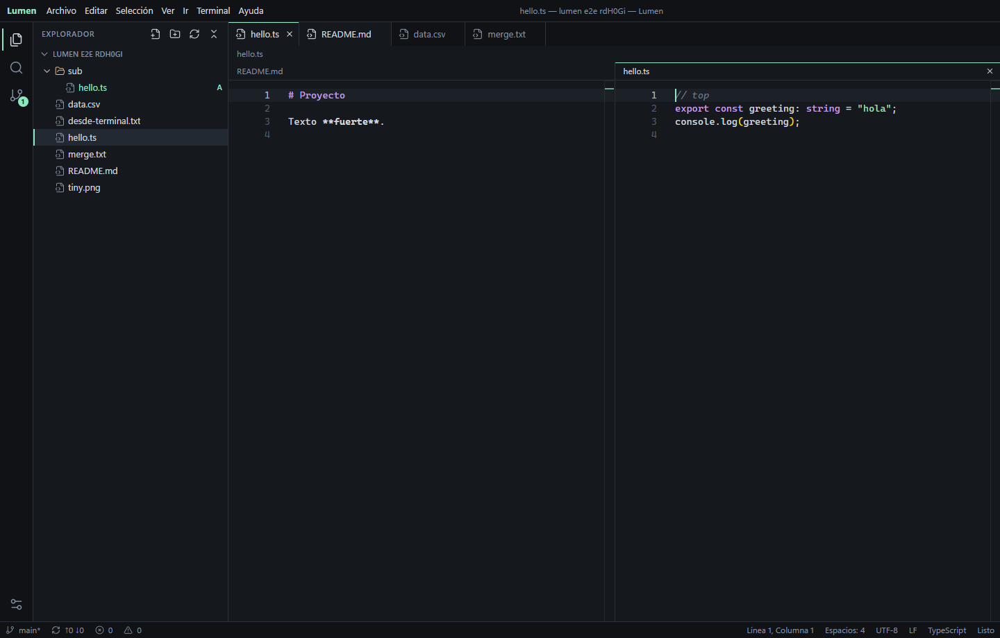

# Lumen

A lightweight desktop IDE built with Rust and Tauri. It pairs the Monaco editor with a real terminal and a complete Git workflow, in an 8 MB executable.

[Leer en español](README.es.md) · [Download for Windows](https://github.com/u0f/lumen-ide/releases/latest)



## Features

**Editor**
- Monaco with tabs, side-by-side split with independent files, diff view and multiple cursors
- Syntax highlighting for 80+ languages; IntelliSense for TS/JS, HTML, CSS and JSON
- Command palette, quick file open, go to line and go to symbol
- Find and replace across files, with regex, whole-word and glob filters
- Previews for Markdown, CSV, images, PDF, audio, video and hex
- Auto reload on external changes, with a conflict dialog when saving over them

**Git**
- Stage, unstage, discard, commit, amend and commit all
- Fetch, pull, push, sync and force push with lease
- Branches, merge, rebase, cherry-pick, revert and reset
- Stashes, tags and remotes
- History graph, per-commit file diffs, gutter markers and inline blame
- Conflict resolution with Accept current, incoming or both

**Terminal**
- Real PTY sessions with a configurable shell
- Task runner for `package.json`, Cargo, Go, Makefile and `.vscode/tasks.json`

**Settings**
- 116 options in a dedicated tab, with search and per-setting reset
- Rebindable keyboard shortcuts
- Spanish, English and Catalan interface

## Keyboard shortcuts

| Action | Keys |
| --- | --- |
| Command palette | `Ctrl+Shift+P` |
| Open file | `Ctrl+P` |
| Toggle console | `Ctrl+J` |
| Split editor | `Ctrl+\` |
| Open to the side | `Ctrl`+click in the explorer |
| Search in files | `Ctrl+Shift+F` |
| Source control | `Ctrl+Shift+G` |
| Settings | `Ctrl+,` |
| Run task | `Ctrl+Shift+B` |
| Run active file | `F5` |

## Build from source

You need [Node.js](https://nodejs.org) 20+, [Rust](https://rustup.rs) and [Git](https://git-scm.com).

- **Windows:** Visual Studio Build Tools with the C++ workload. WebView2 ships with Windows 11.
- **Linux:** the [Tauri system dependencies](https://tauri.app/start/prerequisites/#linux). On Ubuntu 22.04+:

```bash
sudo apt install build-essential curl file libwebkit2gtk-4.1-dev libssl-dev libxdo-dev libayatana-appindicator3-dev librsvg2-dev
```

Then:

```bash
npm ci
npm run bundle
```

Installers land in `src-tauri/target/release/bundle/`. Use `npx tauri build --no-bundle` to produce only the executable, and `npm run desktop` to develop with hot reload.

Pass a folder to open it directly: `lumen-ide C:\path\to\project`.

## Project layout

```
src/                 TypeScript frontend
  main.ts            App shell, commands, shortcuts and wiring
  editor.ts          Monaco, tabs, split panes, diffs, blame
  explorer.ts        File tree and search panel
  git-panel.ts       Source control view
  terminal.ts        Terminal, output and problems panel
  preview.ts         File previews
  settings.ts        Settings schema
  settings-page.ts   Settings tab
  i18n.ts            Translations
src-tauri/           Rust backend
  src/workspace.rs   Sandboxed file access and search
  src/git.rs         Git operations
  src/terminal.rs    PTY sessions
  src/lib.rs         Tauri commands
e2e/app.mjs          End-to-end test of the real app
public/              Static assets
```

To add a setting, add one line to `CATEGORIES` in `src/settings.ts`. Options with `monaco` set reach the editor without further code.

## Tests

```bash
npm test
npx tsc --noEmit
```

The end-to-end suite runs on Windows only. It launches the app with a local WebView2 debug port, which release builds never open, and drives real editing, search, terminal and Git flows:

```bash
npm run test:e2e
```

## Not included

Debugger, VS Code extensions, external language servers, multi-root workspaces, remote development and non-UTF-8 encodings. Languages other than TS/JS, HTML, CSS and JSON get syntax highlighting and word-based completion only, and TS/JS reports syntax errors but not type errors.

Linux support is checked by CI builds; the end-to-end suite does not cover it.

## License

[MIT](LICENSE)
